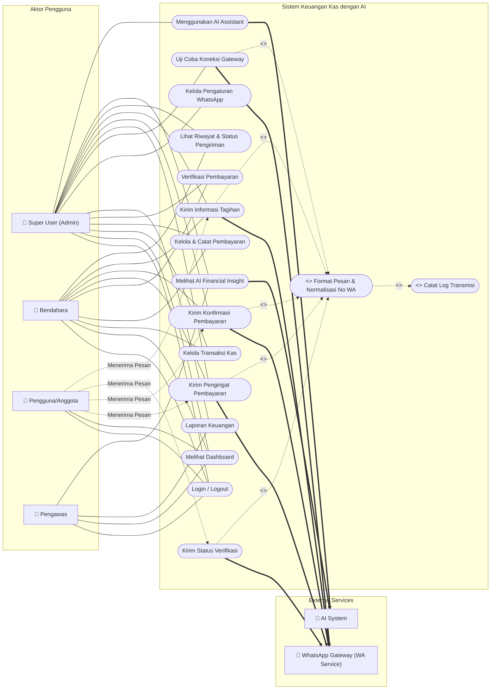

# SPESIFIKASI USE CASE & ARSITEKTUR INTEGRASI WHATSAPP (WA)
**Sistem Keuangan Kas dengan AI**

Dokumen ini menjelaskan integrasi layanan **WhatsApp (WA)** ke dalam sistem pengelolaan kas sekolah/organisasi sebagai **External Supporting Actor / External Service**.

---

## 1. STRUKTUR ACTOR SISTEM

Sistem beroperasi dengan tepat **4 Aktor Utama (Manusia)** dan **2 Aktor Eksternal (Service/System)**:

### Aktor Utama (Human Users)
1. **Super User (Admin)**: Administrator utama sistem dengan hak akses penuh, termasuk konfigurasi gateway WhatsApp dan manajemen sistem.
2. **Pengguna/Anggota**: Anggota kas yang hanya memiliki akses terhadap data keuangan pribadinya serta menjadi **penerima** notifikasi WhatsApp.
3. **Bendahara**: Operator operasional kas yang mencatat setoran, memverifikasi pembayaran, serta memicu pengiriman pengingat dan konfirmasi via WhatsApp.
4. **Pengawas/Penanggung Jawab**: Pihak peninjau dan pengawas laporan serta kondisi kesehatan kas (monitoring).

### Aktor Eksternal (External Supporting Services)
1. **AI System**: Layanan eksternal berbasis LLM / AI untuk analisis data keuangan, insight keuangan, dan asisten interaktif.
2. **WhatsApp (WA)**: Layanan pendukung eksternal (*External Supporting Actor*) yang bertugas mentransmisikan notifikasi pesan kepada nomor telepon anggota yang berhak.

> [!IMPORTANT]
> - **WhatsApp (WA)** adalah **External Service**, bukan user login aplikasi dan tidak memiliki akun/role di tabel pengguna (`users`).
> - WA tidak memiliki antarmuka/dashboard login mandiri dan tidak memiliki hak akses data internal.
> - Kredensial API WhatsApp (Token/Secret) tidak di-hardcode dalam kode sumber, melainkan diamankan di database (`whatsapp_settings`) dan `.env`.

---

## 2. DAFTAR USE CASE TERKAIT WHATSAPP

| Kode UC | Nama Use Case | Aktor Terkait | Deskripsi |
| :--- | :--- | :--- | :--- |
| **UC-WA-01** | Kelola Pengaturan WhatsApp | Super User (Admin) | Mengaktifkan/menonaktifkan integrasi, mengatur API URL, Token/Secret, sender number, dan toggle otomatisasi. |
| **UC-WA-02** | Uji Coba Koneksi Gateway | Super User (Admin) | Melakukan test pengiriman pesan ke nomor tujuan tertentu untuk menguji konektivitas provider gateway. |
| **UC-WA-03** | Kirim Pengingat Pembayaran | Bendahara, Super User | Mengirim pesan pengingat tagihan iuran kas kepada anggota yang belum lunas atau memiliki tunggakan. |
| **UC-WA-04** | Kirim Konfirmasi Pembayaran | Sistem (Otomatis), Bendahara, Admin | Mengirimkan pesan konfirmasi bahwa setoran iuran kas telah berhasil dicatat ke sistem. |
| **UC-WA-05** | Kirim Status Verifikasi | Sistem (Otomatis), Bendahara, Admin | Mengirimkan notifikasi bukti sah verifikasi pembayaran iuran (Lunas/Sebagian) oleh petugas. |
| **UC-WA-06** | Kirim Informasi Tagihan Baru | Bendahara, Super User | Menerbitkan dan menyebarkan informasi kewajiban iuran kas baru ke nomor WhatsApp anggota. |
| **UC-WA-07** | Lihat Status Pengiriman / Log | Super User, Bendahara | Melihat riwayat pengiriman, status (Sent/Failed/Pending), waktu pengiriman, dan pratinjau pesan. |
| **UC-WA-08** | Transmisi Pesan WhatsApp | WhatsApp (External Service) | Menerima payload dari aplikasi dan meneruskan pengiriman pesan ke aplikasi WhatsApp anggota. |

---

## 3. DIAGRAM USE CASE UML



---

## 4. MATRIKS HAK AKSES (ROLE ACCESS MATRIX)

| Modul / Fitur | Super User (Admin) | Bendahara | Pengawas | Pengguna/Anggota | WhatsApp (WA Service) |
| :--- | :---: | :---: | :---: | :---: | :---: |
| **Kelola Pengaturan WhatsApp** | **Full (CRUD)** | ❌ Ditolak (403) | ❌ Ditolak (403) | ❌ Ditolak (403) | N/A (External) |
| **Uji Coba Koneksi Gateway** | **Ya** | ❌ Ditolak | ❌ Ditolak | ❌ Ditolak | Menerima Transmisi |
| **Kirim Pengingat Pembayaran** | **Ya** | **Ya** | ❌ | Hanya Menerima | Menerima Transmisi |
| **Kirim Konfirmasi Pembayaran** | **Ya (Auto/Manual)**| **Ya (Auto/Manual)**| ❌ | Hanya Menerima | Menerima Transmisi |
| **Kirim Status Verifikasi** | **Ya (Auto/Manual)**| **Ya (Auto/Manual)**| ❌ | Hanya Menerima | Menerima Transmisi |
| **Kirim Informasi Tagihan** | **Ya** | **Ya** | ❌ | Hanya Menerima | Menerima Transmisi |
| **Lihat Riwayat Log Pengiriman** | **Ya (Lengkap)** | **Ya (Lengkap)** | ❌ | ❌ Ditolak | Menyediakan Status API |
| **Penerimaan Notifikasi Pesan** | Opsional (Uji Coba) | Opsional | Opsional | **Target Utama** | Pengirim Pesan |

---

## 5. ALUR KERJA (WORKFLOW INTEGRASI)

```text
       [Event Keuangan: Pembayaran / Verifikasi / Pengingat]
                                 │
                                 ▼
                   [Sistem Memvalidasi Data & Izin]
                                 │
                                 ▼
          [WhatsAppService Memeriksa Status 'wa_enabled']
           ├── Nonaktif ──> Selesai (Tidak Kirim Pesan)
           └── Aktif
                 │
                 ▼
       [Format Pesan Dibuat & Nomor HP Dinormalisasi (628xxx)]
                                 │
                                 ▼
        [Catat Baris Log Baru di 'whatsapp_logs' (Status: Pending)]
                                 │
                                 ▼
          [Eksekusi via Provider: Mock / Fonnte / Wablas]
                                 │
                                 ▼
      [Terima Respons Gateway & Perbarui Status (Sent / Failed)]
                                 │
                                 ▼
          [Pesan Diterima oleh Anggota di Aplikasi WhatsApp]
```

---

## 6. KEAMANAN DAN PRIVASI

1. **Prinsip Least Privilege**: Hanya Super User yang dapat membuka menu `whatsapp/settings` dan mengubah parameter gateway.
2. **Kerahasiaan Kredensial**: API Token tidak ditampilkan mentah di layar (menggunakan masking `abc***xyz`).
3. **Penyimpanan Terproteksi**: Tidak ada secret key yang disimpan di file kode publik.
4. **Isolasi Log**: Anggota tidak memiliki endpoint ataupun API untuk membaca log notifikasi anggota lainnya.
